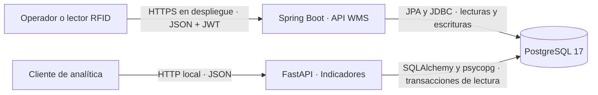

# LogiTrack Core

Sistema de gestión de inventarios (WMS) con movimientos RFID y analítica de demanda por almacén. Registra entradas y salidas, conserva el historial y calcula cobertura y puntos de reorden a partir de los despachos.

Proyecto de portafolio de **Holger Andrés Meneses Jaramillo**. [Perfil de GitHub](https://github.com/wipuchi-coder)

## Arquitectura



| Capa | Responsabilidad |
| --- | --- |
| PostgreSQL | Catálogo, saldo, historial inmutable, restricciones y datos de demostración. |
| Java 17, Spring Boot 3 y Maven | Catálogos, autenticación JWT, movimientos y consultas de saldo. |
| Python 3.12 y FastAPI | Clasificación ABC, cobertura y reorden por almacén. |
| Docker Compose | Construcción y arranque local con comprobaciones de salud. |

## Inicio rápido

1. Inicia Docker con soporte para contenedores Linux y Docker Compose v2.
2. Copia `.env.example` a `.env` y sustituye los tres valores de ejemplo por valores propios. Usa una contraseña del operador de 12 a 256 caracteres y una clave JWT aleatoria de al menos 32 bytes.
3. Desde la raíz ejecuta:

```powershell
Copy-Item .env.example .env
# Edita .env antes de continuar.
docker compose config --quiet
docker compose up --build --wait
docker compose ps
```

Los scripts de inicialización se ejecutan al crear el volumen de PostgreSQL. La semilla carga dos almacenes, seis productos y **372 movimientos** distribuidos a lo largo de 90 días, incluidas las entradas de apertura. `docker compose down` detiene el stack y conserva el volumen.

| Servicio | Documentación interactiva | Salud |
| --- | --- | --- |
| WMS | [Swagger UI](http://localhost:8080/swagger-ui/index.html) | [Actuator](http://localhost:8080/actuator/health) |
| Analítica | [Swagger UI](http://localhost:8000/docs) | [Health](http://localhost:8000/health) |

### API transaccional

En Swagger llama a `POST /api/auth/token` con `username` y `password` de la cuenta configurada. Copia el campo `accessToken` en **Authorize**. El token expira en 15 minutos.

| Método y ruta | Operación |
| --- | --- |
| `GET /api/warehouses`, `GET /api/products`, `GET /api/movements` | Listados paginados mediante `page` y `size`, con un máximo de 100 registros por página. |
| `GET /api/warehouses/{id}`, `GET /api/products/{id}`, `GET /api/movements/{id}` | Consulta de un registro. |
| `POST /api/warehouses` | Alta con `code` y `name`. |
| `POST /api/products` | Alta con `sku`, `name` y `unitCost`. |
| `GET /api/warehouses/{id}/stock` | Saldo por SKU. Utiliza `afterProductId` y `limit` para avanzar por el listado. |
| `POST /api/movements` | Entrada `IN` o salida `OUT`. Admite movimientos manuales y eventos RFID. |

Ejemplo de cuerpo para un evento RFID en un almacén y producto de la semilla:

```json
{
  "warehouseId": 1,
  "productId": 1,
  "kind": "IN",
  "quantity": 5,
  "eventId": "4064427d-7e17-41fb-aaa6-c942ab110a31",
  "epc": "E28011700000021554D6225F"
}
```

El cliente asigna un UUID por evento y reutiliza ese identificador al reintentar la misma solicitud. `epc` identifica la etiqueta y ambos campos se omiten para un movimiento manual. La API devuelve `201` al crear, `200` al repetir un evento idéntico y `409` si el UUID se reutiliza con otros datos o el saldo resulta insuficiente. Usa un UUID nuevo para una lectura independiente de la misma etiqueta.

El backend serializa los reintentos por UUID con un bloqueo transaccional. Un trigger de PostgreSQL actualiza el saldo de forma atómica y aborta toda salida que supere la cantidad disponible. Cada movimiento conserva una copia del costo del producto al registrarse. El servidor asigna la fecha del movimiento al recibirlo.

### API analítica

```text
GET /api/analytics/warehouses/1?window_days=90&lead_time_days=7&safety_days=3
```

Los parámetros son días enteros. La ventana admite de 1 a 365 y los otros parámetros de 0 a 365. El resultado incluye los SKU con saldo registrado en el almacén, incluso si llegaron a cero.

- **ABC** ordena los SKU por costo histórico de las unidades despachadas. Un SKU pertenece a A si el acumulado previo está por debajo del 80 %, a B si está por debajo del 95 % y a C en los demás casos. Los valores nulos de consumo monetario se representan como cero y se clasifican en C. El ID desempata.
- **Cobertura** divide el saldo entre la demanda diaria media. Sin demanda, la cobertura es `null`.
- **Reorden** redondea hacia arriba la demanda media multiplicada por la suma del plazo de entrega y los días de seguridad. Con demanda observada, el indicador se activa cuando el saldo alcanza ese punto o cae por debajo. Los días de seguridad son un parámetro fijo.
- Los campos decimales se serializan como cadenas para preservar su precisión.

## SQL y pruebas

`database/analytics.sql` incluye cinco consultas comentadas con CTE y funciones de ventana. Cubre ABC global, media móvil de demanda, días de cobertura, principales despachos por almacén y saldo histórico acumulado. Para ejecutarlas en Compose sin exponer PostgreSQL al host:

```powershell
Get-Content -Raw database/analytics.sql |
    docker compose exec -T postgres sh -c 'psql -X -v ON_ERROR_STOP=1 -U "$POSTGRES_USER" -d "$POSTGRES_DB"'
```

Desde la raíz, con JDK 17, Maven y un entorno Python 3.12:

```powershell
mvn -f backend-java/pom.xml test
Set-Location service-python
python -m pip install -r requirements.txt
python -m pytest -q
```

La configuración Compose está orientada al desarrollo local. Los puertos HTTP se publican en loopback y PostgreSQL queda en la red interna. FastAPI usa transacciones de solo lectura y el mismo usuario de base configurado para la demostración. En un despliegue compartido, la analítica requiere autenticación, TLS y una cuenta de PostgreSQL con permisos limitados a lectura.
